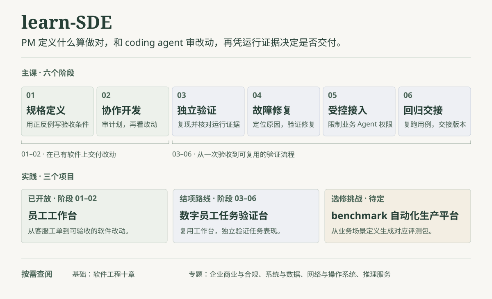

# learn-SDE · AI 产品经理的软件工程实践课

从一个已有的客服工单台开始。第一课亲手办一笔虚构退款申请，写清什么算办对；第二课让 coding agent 在终态区显示工单真正关联的草案编号，你负责判断这次改动是否可以交付。v0.1 提供这两课及其起始工程。

**先看基础**　[基础第 1 章](library/foundations/media/ch01.mp4) 与 [第 4 章](library/foundations/media/ch04.mp4) 合计 6 分 35 秒。另有[按章阅读的核心教材索引](library/README.md)。

**直接上手**　[第一课 · 定义可验证的需求](learning/lesson-01.md) → [第二课 · 审计划、验改动](learning/lesson-02.md)。喜欢网页阅读可下载完整仓库，打开根目录的 [HTML 学习手册](handbook.html)，或启动工作台并从页首进入手册。GitHub 文件页可直接阅读以上 Markdown 讲义。

## 启动工单台

在本地下载或克隆自己的副本，进入**包含 package.json 的文件夹**，在终端运行：

```sh
node --version
npm start
```

需要 Node.js 20 或更新版本。项目只用 Node.js 标准库，直接启动即可。浏览器打开终端打印的本地地址，保持终端开着；学完按 Ctrl+C 停止服务。第一课可手动或用规则脚本执行。第二课自选能编辑本地文件的 coding agent，费用和账号要求取决于你的工具。请只开放自己的练习副本。

| 进度 | 你交付什么 | 怎样自检 |
| --- | --- | --- |
| 第一课 | 业务任务卡与小功能需求卡 | 能分别解释正常、缺凭证、缺权限三个结果，并给出本轮工单、草案与支付证据。 |
| 第二课 | 一次小的软件改动与收货决定 | 能演示已建未关联、关联后、复位和两个停止分支，并跑通基础检查及功能专项检查。 |

从 [空白工作纸](learning/worksheet.md) 开始，把自己的答卷、改动和运行导出保存在个人副本。做完再读 [教师示例](learning/teacher.md)。用第二个终端运行 `npm test` 检查已有行为；`npm run verify:lesson-2` 检查要新增的显示行为，原始工程预期在此项失败。

## 课程全貌



阶段 1–2 是本版的客服工单台实践。阶段 3–6 是后续结项路线，逐步训练独立验收、故障修复、业务 Agent 受控接入和回归交接。选修挑战 **TBD**：为多个工作场景自动生产各自的 benchmark。四个专题和十章软件工程基础可从[教材目录](library/README.md)随阶段查阅。[外部阅读与课程来源](learning/sources.md)
